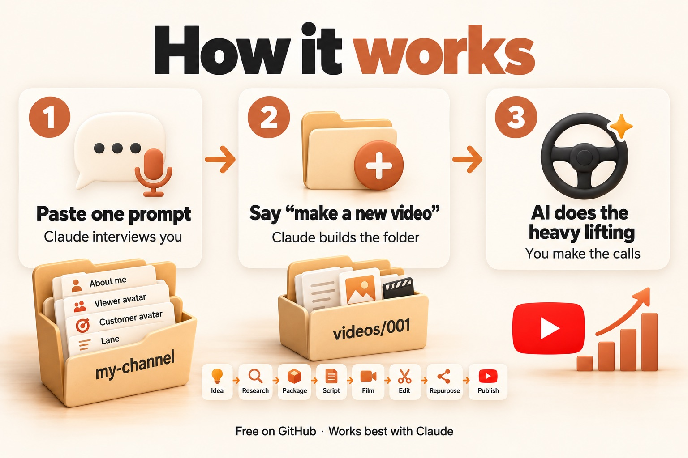

# Grow Your Business with YouTube (and Let AI Do Most of the Work)

A free course by Samin Yasar.

You'll learn how to use YouTube to grow your business. AI does most of the heavy lifting. You make the calls.

- Watch the course: [Video link]
- Join the free community: [Community link]



## Start here: copy this prompt

This one prompt sets everything up for you. Then Claude builds your first files with you: **you** (an audit of who you are and what you know), **your viewer** (why they watch, and why they buy), and **your lane** (where the two overlap). At the end, it makes a one-page visual of your viewer and opens it in your browser. It takes about 30 minutes.

1. **Get Claude.** Download the Claude desktop app from [claude.ai/download](https://claude.ai/download) and sign in. I recommend the Opus model.
2. **Open the Code tab** in the desktop app and choose a folder. If you downloaded this course already, pick its folder. If not, pick your Documents folder, and Claude will download the course for you.
3. **Paste this prompt** and press Enter. On GitHub, click the copy icon in the top-right corner of the box.

````text
Set up my AI YouTube course and onboard me.

1. Find the course folder. If the folder you're in has ONBOARDING.md, CLAUDE.md and a chapters/ folder, use it. If not, download the course from https://github.com/Samin12/ai-youtube-course into a folder called ai-youtube-course in my Documents folder (use git clone, or download and unzip the ZIP if git isn't installed), and work inside it from now on.
2. Read ONBOARDING.md and follow its "For the AI" section, step by step.
3. Explain what you're doing in plain English as you go. Ask before installing anything.
````

**What happens next:** Claude sets things up, opens all the questions in your browser so you can see everything up front, and asks how you'd like to go:

1. **One by one:** Claude asks each question, and you answer.
2. **All at once:** you read the questions, then turn on voice and talk through everything in one go. This is the fastest way.

Want to see the questions first? Here's the full list: [`QUESTIONS.md`](QUESTIONS.md).

**Want to stop and come back later?** Just say "pause." Next time, open the course folder in Claude and say "continue onboarding." Everything you've answered is saved.

**Using a regular chat or ChatGPT?** It works there too. Copy everything in [`ONBOARDING.md`](ONBOARDING.md) and [`QUESTIONS.md`](QUESTIONS.md) and paste it into a new chat. The AI interviews you the same way and hands you each finished file to save.

## Who this is for

- Business owners
- Agency and service owners
- Knowledge workers
- Anyone building an online business

You don't need to be technical. If you can copy and paste, you can do this.

## How the course works

First you learn the concepts for each stage. Then we build one real video together, start to finish.

Think of a self-driving car. The car does most of the driving, but you're still in the driver's seat. And you still need to know how to drive, so you can grab the wheel when it does something weird. AI works the same way.

At the end, we put an AI agent team on top of everything, so it runs on autopilot.

**The map:** Foundation → Ideation → Research → Packaging → Script → Film → Edit → Repurpose → Publish → Funnel → Autopilot

**This folder is your content operating system.** `my-channel/` holds who you are and who you make videos for. `videos/` holds one folder per video. `CLAUDE.md` is what Claude remembers about you. Set it up once, and every new video starts with "make a new video."

## The chapters

| # | Chapter | What you build | Status |
|---|---|---|---|
| 00 | [Start here](chapters/00-start-here/README.md) | Your setup: Claude, this repo, and the onboarding prompt | **Ready** |
| 01 | [Foundation](chapters/01-foundation/README.md) | `my-channel/`: about you, viewer avatar, offer, lane, brand voice | **Ready** |
| 02 | [Ideation](chapters/02-ideation/README.md) | `videos/<your-video>/01-idea.md` | Outline ready, build coming soon |
| 03 | [Research](chapters/03-research/README.md) | `videos/<your-video>/02-research.md` | Outline ready, build coming soon |
| 04 | [Packaging](chapters/04-packaging/README.md) | `videos/<your-video>/03-packaging.md` | Outline ready, build coming soon |
| 05 | [Script](chapters/05-script/README.md) | `videos/<your-video>/04-script.md` | Outline ready, build coming soon |
| 06 | [Film](chapters/06-film/README.md) | `videos/<your-video>/05-film-checklist.md` | Outline ready, build coming soon |
| 07 | [Edit](chapters/07-edit/README.md) | `videos/<your-video>/06-edit-notes.md` | Outline ready, build coming soon |
| 08 | [Repurpose](chapters/08-repurpose/README.md) | `videos/<your-video>/07-repurpose.md` | Outline ready, build coming soon |
| 09 | [Publish](chapters/09-publish/README.md) | `videos/<your-video>/08-publish.md` | Outline ready, build coming soon |
| 10 | [Funnel](chapters/10-funnel/README.md) | `my-channel/funnel-map.md` | Outline ready, build coming soon |
| 11 | [Autopilot](chapters/11-autopilot/README.md) | Your first skill, then the full autopilot setup | Outline ready, build coming soon |
| 12 | [Tips and next steps](chapters/12-tips-and-next-steps/README.md) | A plan for your next video | Outline ready, build coming soon |

"Outline ready" means the concepts, prompts and templates are in the folder and you can try them now. The full walkthrough is coming soon.

## How to use this repo

A "repo" (short for repository) is just a folder of files that lives online. This one holds everything you need for the course.

**1. Get the files.**

- **Easiest:** click the green **Code** button at the top of this page, then **Download ZIP**. Unzip it somewhere you can find it, like your Desktop.
- **If you use Git** (a tool for copying and tracking files): `git clone https://github.com/Samin12/ai-youtube-course.git`

**2. Open your AI tool.**

Any AI tool works. I recommend the **Claude desktop app** with **Claude Opus**. That's what I use.

**3. Do the chapters in order.**

Start with the [onboarding prompt](#start-here-copy-this-prompt) above. It covers Chapter 0 and Chapter 1 for you. Chapter 1 is required before the rest, because every later chapter builds on it.

## What's in this folder

```
CLAUDE.md          Your "about me" file for AI. Claude reads it every time.
ONBOARDING.md      The steps Claude follows when you paste the onboarding prompt.
QUESTIONS.md       Every onboarding question in one list. Read it, then talk through it.
questions.html     The same questions as a visual checklist. Claude opens it when onboarding starts.
chapters/          One folder per chapter. Each has a README, prompts, and sometimes templates.
my-channel/        Your channel files: about me, offer, viewer avatar, customer avatar, lane, brand voice, funnel map,
                   plus avatar-profile.html, a one-page visual of your viewer. Fill these in once.
videos/            One folder per video. Say "make a new video" and Claude makes the next one from videos/_template/.
examples/samin/    My filled-in examples, so you can see what "done" looks like.
.claude/skills/    The same steps as Claude skills (saved instructions Claude can run for you).
```

Inside each chapter:

- `README.md`: why it matters, what you'll learn, the steps, and a checklist.
- `prompts/`: copy-and-paste prompts. They work in any AI tool.
- `templates/`: blank forms and checklists (only where they help).

**Making a video?** Open this folder in Claude and say **"make a new video."** Claude makes the next numbered folder in `videos/` (like `videos/001-my-first-video/`), writes the brief, and starts Ideation with you. Say **"continue my video"** to pick up where you left off, or **"show my videos"** to see them all. More in [`videos/README.md`](videos/README.md).

**Skills** work in Claude Code, the version of Claude that can read and save files on your computer (the Code tab in the desktop app). Type `/onboarding` to run the whole onboarding, `/new-video` to start a video, or `/viewer-avatar` to run just the viewer avatar interview. You can also just ask in plain English, like "make a new video."

**Can't see the `.claude` folder?** Folders that start with a dot are hidden. On a Mac, press **Cmd + Shift + .** in Finder to show them. On Windows, turn on **View > Hidden items** in File Explorer.

## Questions?

Ask in the community: [Community link]
