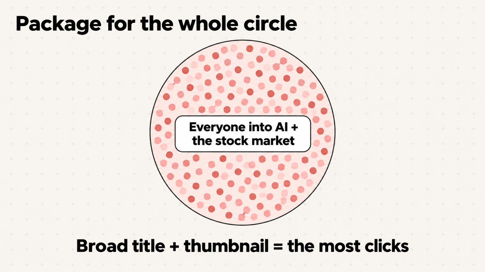
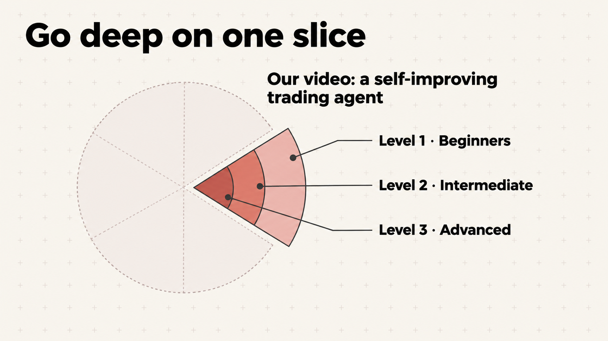
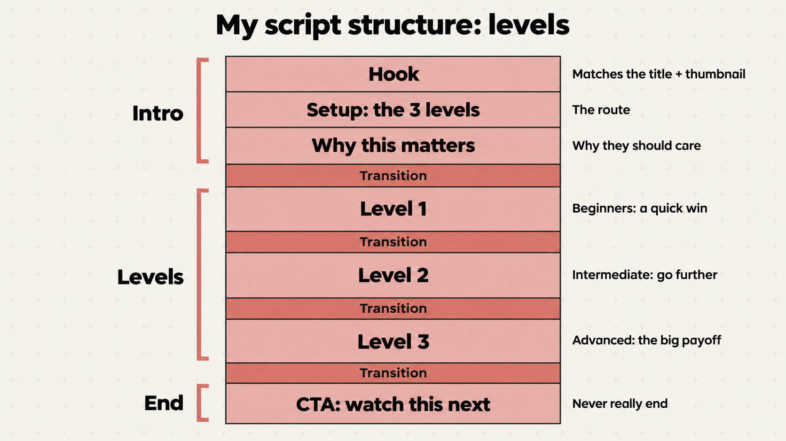
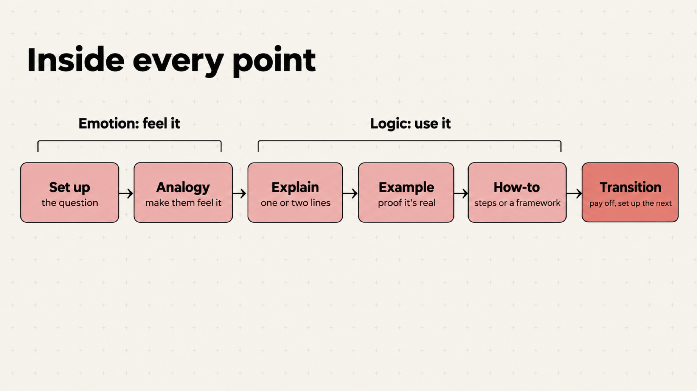

# Chapter 5: Outline + script

**Stage 4 of 8:** Ideation → Research → Packaging → **Outline + script** → Film → Edit → Repurpose → Publish

## Why this matters

The title and thumbnail made a promise. The script keeps it. Viewers arrive with "an expectation and a doubt": the hook removes the doubt, the body delivers. *(Jake Trinder)* Every script comes down to one question: what's the one point you're building to, and how do you create tension along the way? *(Jon Dorman)*

## What you'll learn

- **Write the promise first.** Your title and thumbnail make one promise. Write it in one sentence, in the viewer's words, then list what the video must show to keep it. Same video, different package: a different promise, hook and format.
- **Package the whole circle, go deep on one slice.** A fitness magazine cover says "Get in the best shape of your life," and almost anyone picks it up. Inside, it's one 20-minute workout. The package reaches the most people; the video goes deep on one thing.  
- **Levels.** Like a ski resort: same mountain, green runs to black diamonds. A broad package brings in every level at once, so the video goes easy to hard: Level 1 is a quick win for beginners, Level 3 is the advanced payoff. 
- **People need to be reminded more than they need to be taught.** Pilots still read the checklist before every flight. Repeat the basics in every video.
- **Inside every point.** Set up → analogy → explain → example → how-to → transition. Feel it first, then use it. One analogy per point, never two. 
- **Outline first, using acceptance criteria.** In software, acceptance criteria are the checklist that must pass before a feature counts as done. Treat your title the same way: "What has to be true by the end for the title to be true?" That list is your points. *(Jake Trinder)*
- **The hook (first 5–30 seconds) and the 4 P's.** Promise: is this what I clicked for? Proof: why should I listen to you? (one proof line you reuse every video) Plan: how are you getting me there? Persona: is this for me? *(Jake Trinder)*
- **Match the click.** First sentence matches the title, first shot matches the thumbnail. *(Aprilynne Alter)* Never open with "sup guys, hit like": that's about 30 seconds gone. *(Jon Dorman)*
- **Input bias.** People value what took effort, so say how much work went in. *(Aprilynne Alter)*
- **Each point = setup → tension → payoff.** Setup names the viewer's fear or question. Tension holds back the answer and shows evidence. Payoff gives the takeaway. *(George Blackman, in Aprilynne Alter's course)* Build to one climax, not two. *(Jon Dorman)*
- **Transitions.** The biggest drop-off after the hook is the gap between one payoff and the next setup. *(George Blackman)* So every transition says why the next part matters. Ask: "Why wouldn't they click off here?" *(Marcus Jones)*
- **Analogies and examples.** An analogy makes a problem you can't see physical, like jelly beans in glasses for channel size. *(Ed Lawrence)* Borrow an idea from another field, explain it in one line, tie it to your point. *(Jake Trinder)* My rule: analogy or example first, then the point.
- **The ending.** The best call to action (CTA) is "watch this next video." *(Rene Ritchie, in Aprilynne Alter's course)* Make the CTA a give, not a take. *(Jake Trinder)*
- **How much to write out.** Levels: 5–10 key points → add setup/tension/payoff → word for word. *(George Blackman)* Bullets for everything except the hook, which is word for word. *(Nate Curtiss)* I write the full script for a teleprompter, one sentence per line, with transitions written in. Don't script screen-recording demos; talk through them. *(Jake Trinder)*

## What you'll build

[`videos/<your-video>/04-script.md`](../../videos/_template/04-script.md): your one-page outline (the one-pager), then your script. Say "make the outline" and Claude writes the one-pager from your idea doc and package (skill: `video-outline`). See a finished one: [`examples/samin/video-one-pager-ai-trader.md`](../../examples/samin/video-one-pager-ai-trader.md), and the one behind my 1.8M video: [`examples/samin/video-one-pager-stock-market.md`](../../examples/samin/video-one-pager-stock-market.md). The full structure, with notes, is in [`templates/script-architecture.md`](templates/script-architecture.md).

## Steps

1. **Outline.** Say **"make the outline"** (skill: `video-outline`). Claude asks you a few questions, or you talk it all through at once, so it gets your brain dump: the stories and results only you have. It organizes that in your words (and puts it on your Poppy board if it's connected), then writes the promise and the one-pager: Intro, Why this matters, Levels 1–3, CTA. No Claude Code? Run [`prompts/acceptance-criteria-outline.md`](prompts/acceptance-criteria-outline.md); it turns your title and research outline into must-be-true points.
2. **Hooks.** Run [`prompts/hook-variations.md`](prompts/hook-variations.md). Pick one and check it hits all 4 P's. *(Nate Curtiss)*
3. **Draft in your voice.** Run [`prompts/draft-script.md`](prompts/draft-script.md). Feed it your past transcripts and your brain dump from Research, so it doesn't sound like generic AI.
4. **Add transitions and an analogy for every point.**
5. **Read it out loud and cut.** "If you're not taking out 10%, you're not trying very hard." *(Jon Dorman)*
6. **Save** it in `videos/<your-video>/04-script.md`.

## Check it

- [ ] Does the hook hit all 4 P's?
- [ ] Does every point have setup, tension, payoff, and an analogy or example?
- [ ] Is there a transition between every point?
- [ ] Does the script deliver everything on your acceptance-criteria list?
- [ ] Read it out loud. Rewrite anything you trip over. *(Aprilynne Alter)*

## Tips

- **Dictate a draft** and use the transcript, so it sounds human. *(Aprilynne Alter)*
- **Let a script sit for a few days,** then read it aloud. *(Ed Lawrence)*
- **Paste a top outlier's transcript into AI** and ask it to break down the structure. *(Marcus Jones)*

## Status

**Coming soon.** Outline ready: the concepts, prompts and template work now. The full walkthrough is coming.

Next: [Chapter 6: Film](../06-film/README.md).
